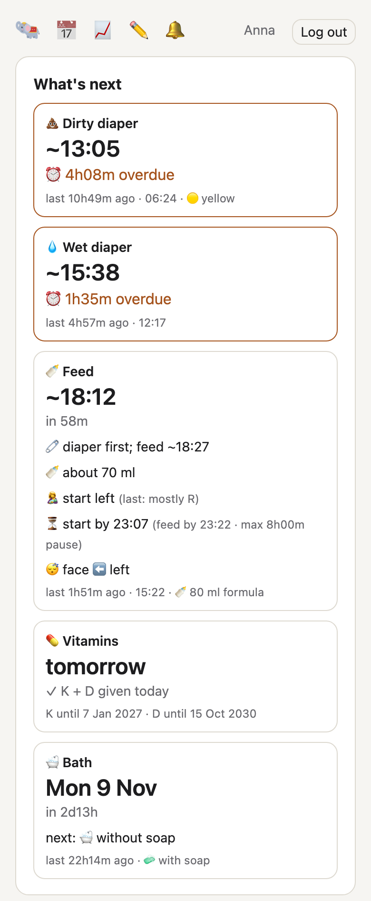
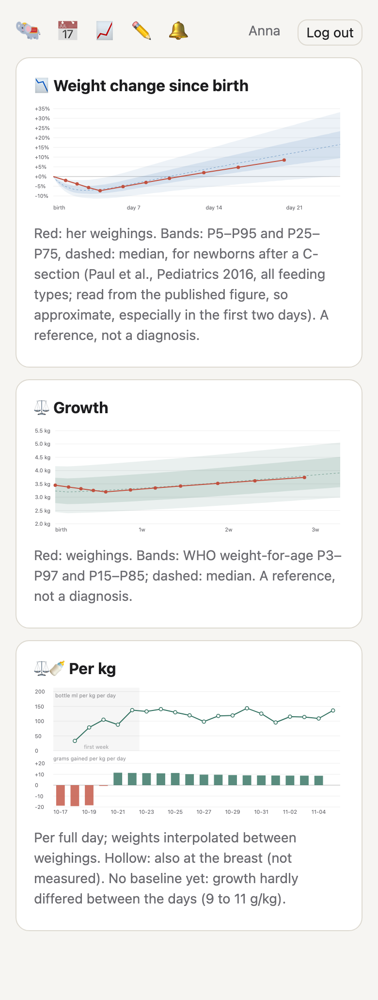
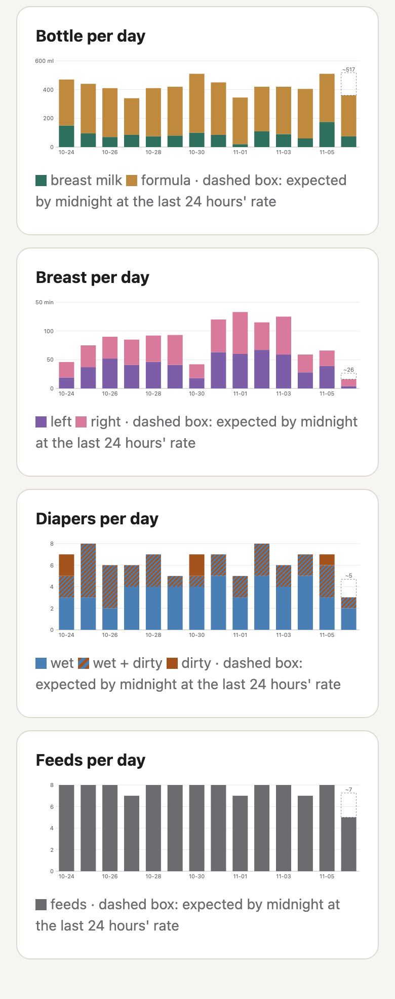
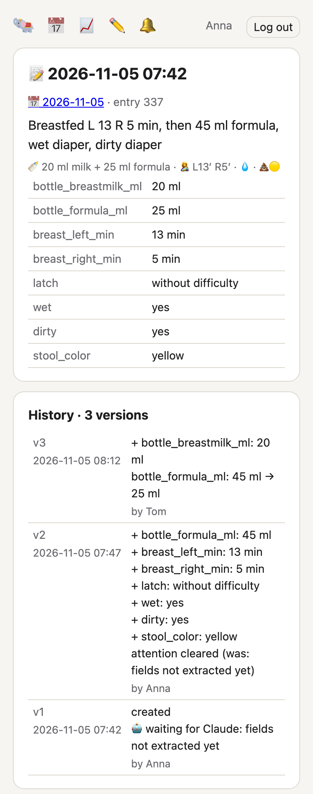

# baby-mcp

> [!NOTE]
> :robot: During the kraamweek we logged our newborn's feeds and diapers in the
> maternity nurse's portal, by just telling Claude through
> [healthsoft-mcp](https://github.com/bwesterb/healthsoft-mcp). When the
> kraamweek ended, that portal closed, and we still wanted to keep track. So I
> asked Claude to write our own baby log: an MCP server, so I can just
> tell Claude "she drank 90 ml and had a wet diaper" or ask when the next feed is
> due, plus a small web app for the phone with reminders. This is the result.
> Works well for us, but of course: no guarantees and provided as-is! Not medical
> advice, and not affiliated with Healthsoft.

An MCP-first baby logger, with a dashboard with graphs and web notifications.
You log and ask through Claude (or another assistant); the web app on the phone
shows what's next, the log and charts. One instance is for one baby; several
parents log in with their own passkeys.

Screenshots with made-up data.

- **Log by talking.** Each entry is one moment (a feed, a diaper, a weighing, or
  several at once) with the text as said and structured fields from a fixed
  registry. Every change is kept as a version.
- **Ask.** `status` gives the last feed and diapers, estimates of what's next,
  feeding guidance, the next sleeping side, baths and vitamins due, and growth
  against references.
- **Web app** (installable on the home screen): what's next, today's totals and
  log, charts, entry history, and a free-text form. A timeline of emojis runs
  from birth to the hours ahead: swipe back and the log below follows the day
  in view; pinch to zoom out to a summary per day, or per week of life.
- **Push notifications** (Web Push) and an app-icon badge for feeds, entries
  that need a parent, vitamins and the feeding minimum.

## Tools

| tool | what |
|---|---|
| `log` | add an entry: text plus fields; warns about a likely duplicate |
| `update` / `delete` / `undelete` | change an entry by id; earlier versions are kept |
| `entries` | entries in a time range |
| `history` | all versions of an entry |
| `attention` | entries marked for an agent (or a parent) to look at |
| `status` | the current situation, estimates, feeding guidance, reminders |
| `stats` | per-day totals: feeds, ml, breast minutes per side, diapers, temperature, weight |
| `fields` | the field registry |
| `sql` | read-only SQL over the log (with an authorizer limiting tables and columns) |
| `suggest` | the agent records a wished-for feature for the maintainer |

Fields: bottle breast milk and formula (ml), minutes at the left and right
breast, latch, pumped ml, wet, dirty, stool colour, spit-up, temperature,
weight, sleeping side, bath (with or without soap, or sponge), vitamin K and D.

## Guidance and references

All of it is a rule-of-thumb guide; a plan from a midwife, nurse or doctor
takes precedence.

- **Next feed**: the median recent gap; the amount from a first-week build-up
  (about 10 ml × day of life per feed), then 150 ml/kg/day.
- **Feeding minimum**: the NVK advice for healthy term babies (*Advies ten
  aanzien van wakker maken van pasgeborenen voor voeding*, 2016): minimum feeds
  per 24 h and longest pause by age and weight, with an optional higher aim.
  "At the latest" and warnings follow from it.
- **Which breast to start with**: the side used less over the last 24 hours.
- **Growth**: WHO weight-for-age percentiles, and the first-month weight change
  against newborns with the same delivery mode (Paul et al., Pediatrics 2016).
  The tables are not in this repository; see [`data/README.md`](data/README.md).
- **Vitamins**: K daily from day 8 until 12 weeks (not on a day after at
  least 500 ml of formula, which has enough vitamin K), D from day 8 until 4 years
  (the Dutch advice).

## Access

- **People**: passkeys (WebAuthn). An admin command prints a single-use
  enrollment link per person. A *viewer* (say a grandparent) only sees the
  charts, up to yesterday: no log, no today's running totals, no
  notifications, no changes and no MCP.
- **Assistants**: the server is its own OAuth 2.1 authorization server, per the
  MCP authorization spec: dynamic client registration (redirects only to
  `oauth_redirect_hosts` over https, or localhost), authorization code with
  PKCE, approval with a passkey, access tokens of 1 hour bound to the MCP
  resource, rotating refresh tokens of 30 days.
- Web pages use a strict Content-Security-Policy (only the server's own files,
  nothing inline) and refuse cross-site form posts.
- Pushes carry only a random message id, encrypted per RFC 8291 and signed with
  VAPID (RFC 8292); the service worker fetches the text from the server, so the
  push service never sees it.

## Configuration

`/etc/baby-mcp/config.toml` (see [`deploy/config.example.toml`](deploy/config.example.toml)):

| key | meaning |
|---|---|
| `origin` | public origin, e.g. `https://baby.example.com`; also the passkey relying party, so effectively permanent |
| `listen` | listen address, default `127.0.0.1:8095` |
| `state` | state directory (SQLite database, reference tables) |
| `tz` | time zone for clock times |
| `oauth_redirect_hosts` | hosts OAuth clients may redirect to, default `claude.ai`, `claude.com` |
| `growth_table`, `weight_change_table` | paths of the reference tables, default in the state directory |
| `baby.name`, `baby.birth`, `baby.birth_weight_g` | the baby |
| `baby.sex`, `baby.delivery` | select the WHO standard and the weight-change reference |
| `baby.aim_feeds_per_day` | plan at least this many feeds per 24 h |
| `baby.feed_prep_minutes` | start the routine (diaper first) this long before a feed |

## Building and running

    cargo build --release
    # or, for a static Linux binary:
    cargo zigbuild --release --target x86_64-unknown-linux-musl

Run it behind a reverse proxy that terminates TLS, on a host name of its own
(the OAuth discovery documents live at the root). [`deploy/`](deploy/) has a
hardened systemd unit and a Caddy snippet.

Admin commands, run on the server as the service user:

    baby-mcp user add NAME "Display name" [--viewer]   # create a user; prints an enrollment link
    baby-mcp user role NAME parent|viewer   # change what a user may see and do
    baby-mcp enroll NAME                    # a new single-use enrollment link (30 min)
    baby-mcp passkeys                       # passkeys, OAuth clients, active tokens
    baby-mcp remove-passkey ID
    baby-mcp revoke-all                     # end all sessions and tokens
    baby-mcp suggestions [--all]            # features the agent asked for
    baby-mcp done ID [--note TEXT]          # mark a suggestion done (or: reject)
    baby-mcp status                         # what `status` returns, as JSON
    baby-mcp push-test NAME                 # a test notification to a user's devices
    baby-mcp export                         # everything, with all versions, as JSON
    baby-mcp import-healthsoft FILE --as NAME   # import a Healthsoft kraamzorg export

[`DESIGN.md`](DESIGN.md) describes the data model and the choices behind it.

## License

MIT
